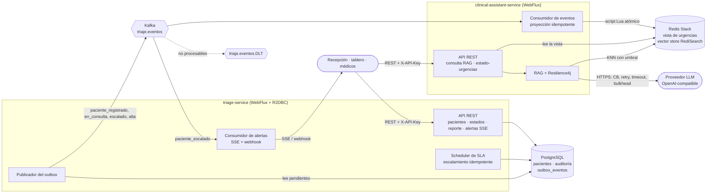
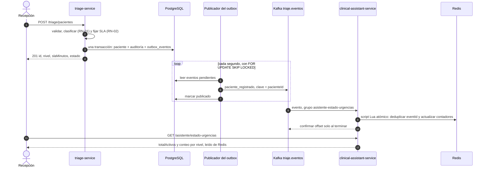
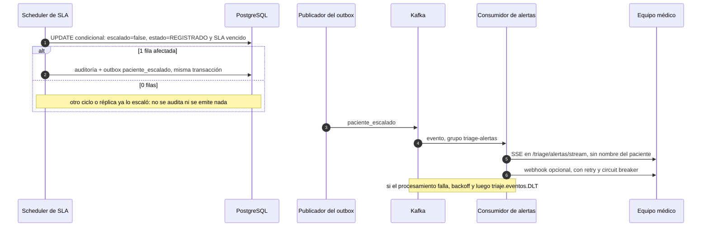

# VidaCruz Triage Digital

       [](https://github.com/SantiagoGL2/vidacruz-triage-digital/actions/workflows/ci.yml)  -96%25-brightgreen)

Sistema de triaje digital para las urgencias de VidaCruz, hecho con dos microservicios reactivos (Spring WebFlux, R2DBC, Kafka):

* **`triage-service`** registra pacientes con sus signos vitales, los **clasifica por reglas objetivas** (RN-01), vigila el SLA y **escala automáticamente** a quien lo supera (RF-03), **audita** cada cambio (RN-04), reporta la operación por hora con **SQL avanzado** (RF-05), alerta al equipo médico (RF-06) y publica eventos a Kafka con *Transactional Outbox*.
* **`clinical-assistant-service`** responde preguntas sobre protocolos clínicos con **RAG y cita obligatoria, sin inventar contenido** (RN-05) y mantiene en Redis el estado de urgencias en tiempo real a partir de los eventos de Kafka. **El triaje nunca depende de la disponibilidad del asistente.**

**Índice:** [1. Probar en Azure](#1-probar-en-azure) · [2. Ejecutar en local](#2-ejecutar-en-local-con-un-solo-comando) · [3. Arquitectura](#3-arquitectura) · [4. Requerimientos](#4-cómo-se-cumple-cada-requerimiento) · [5. Decisiones (ADR)](#5-decisiones-clave) · [6. Resiliencia](#6-resiliencia) · [7. IA / RAG](#7-ia--rag) · [8. Seguridad](#8-seguridad) · [9. Observabilidad](#9-observabilidad) · [10. Pruebas](#10-pruebas) · [11. Azure](#11-despliegue-en-azure) · [12. Limitaciones](#12-limitaciones-conocidas-y-siguientes-pasos) · [13. Supuestos](#13-supuestos) · [14. Uso de IA](#14-uso-de-ia-en-el-desarrollo)

**¿Cómo verifico que se cumple todo el enunciado?** [`docs/trazabilidad.md`](docs/trazabilidad.md): cada requerimiento → dónde está implementado → qué pruebas lo verifican, más una sección de **brechas** conocidas. Cobertura: [`docs/cobertura.md`](docs/cobertura.md) · Trazas y métricas: [`docs/observabilidad.md`](docs/observabilidad.md).

---

## 1. Probar en Azure

| Servicio | URL pública | Swagger UI |
|---|---|---|
| `triage-service` | <http://vidacruz-triage-lxwjvy.eastus.cloudapp.azure.com> | [/swagger-ui.html](http://vidacruz-triage-lxwjvy.eastus.cloudapp.azure.com/swagger-ui.html) |
| `clinical-assistant-service` | <http://vidacruz-asistente-lxwjvy.eastus.cloudapp.azure.com> | [/swagger-ui.html](http://vidacruz-asistente-lxwjvy.eastus.cloudapp.azure.com/swagger-ui.html) |

* Es un entorno de **prueba**, en HTTP y temporal (se destruye con `infra/destroy.*`, ver [sección 11](#11-despliegue-en-azure)). `GET /actuator/health/**` y Swagger son públicos; **todo lo demás exige `X-API-Key`**.
* **Las API keys se entregan por separado** (no están en el repositorio). En Swagger UI: **Authorize** → pegar la clave del servicio.
* Los ejemplos usan bash (Linux, macOS, WSL o Git Bash; en PowerShell usar `curl.exe`). Los cuerpos van sin tildes a propósito: el `curl` de Windows no siempre las envía en UTF-8.

```bash
export TRIAGE=http://vidacruz-triage-lxwjvy.eastus.cloudapp.azure.com
export ASISTENTE=http://vidacruz-asistente-lxwjvy.eastus.cloudapp.azure.com
export TRIAGE_API_KEY=<clave de triage entregada por separado>
export ASSISTANT_API_KEY=<clave del asistente entregada por separado>
```

**1. Registrar al paciente E1** (RF-01) → `201`, nivel `CRITICO`, SLA de 5 minutos:

```bash
curl -s -X POST "$TRIAGE/triage/pacientes" -H "X-API-Key: $TRIAGE_API_KEY" -H "Content-Type: application/json" \
  -d '{"nombreCompleto":"Carlos Perez","edad":58,"frecuenciaCardiaca":130,"presionSistolica":180,"presionDiastolica":110,"spo2":97,"temperatura":36.8,"dolor":8,"gcs":15,"quejaPrincipal":"Dolor toracico"}'
# {"id":"…","nivel":"CRITICO","nivelNumero":1,"slaMinutos":5,"estado":"REGISTRADO","fechaRegistro":"…"}
ID=<pegar el id de la respuesta>
```

**2. Cambiar el estado** (RF-02) → `200`; repetir con `REGISTRADO` da `409` (transición inválida) y `GET /triage/pacientes/$ID` devuelve el paciente con el tiempo en el estado actual:

```bash
curl -s -X PATCH "$TRIAGE/triage/pacientes/$ID/estado" -H "X-API-Key: $TRIAGE_API_KEY" -H "Content-Type: application/json" -d '{"estado":"EN_CONSULTA"}'
curl -s "$TRIAGE/triage/pacientes/$ID" -H "X-API-Key: $TRIAGE_API_KEY"
```

**3. Reporte de operación por hora** (RF-05; el rango es `[desde, hasta)` con offset obligatorio):

```bash
curl -s -G "$TRIAGE/triage/reportes/operacion" -H "X-API-Key: $TRIAGE_API_KEY" \
  --data-urlencode "desde=$(date -u +%Y-%m-%d)T00:00:00+00:00" --data-urlencode "hasta=$(date -u +%Y-%m-%d)T23:59:59+00:00"
```

**4. Estado de urgencias en tiempo real** (RF-04 B; sale de Redis, alimentado por Kafka, sin llamar a triage) → `totalActivos` y conteo por nivel:

```bash
curl -s "$ASISTENTE/asistente/estado-urgencias" -H "X-API-Key: $ASSISTANT_API_KEY"
```

**5. Pregunta al asistente, con fuentes** (RF-04 A) → respuesta del PROTO-001 y `fuentes` con protocolo y sección:

```bash
curl -s -X POST "$ASISTENTE/asistente/consulta" -H "X-API-Key: $ASSISTANT_API_KEY" -H "Content-Type: application/json" \
  -d '{"pregunta":"Cuales son las medidas iniciales ante una crisis hipertensiva?"}'
# {"respuesta":"Reconfirmar la presión tras 5 minutos de reposo. No reducir la presión más de un 25% en la primera hora. …","fuentes":[{"protocolo":"PROTO-001","seccion":"Medidas iniciales"}]}
```

**6. Pregunta sin protocolo** → respuesta explícita, `fuentes: []` y ningún contenido clínico:

```bash
curl -s -X POST "$ASISTENTE/asistente/consulta" -H "X-API-Key: $ASSISTANT_API_KEY" -H "Content-Type: application/json" \
  -d '{"pregunta":"Cual es el tratamiento de primera linea para la diabetes tipo 2?"}'
# {"respuesta":"No existe un protocolo disponible en el corpus oficial para responder esta pregunta.","fuentes":[]}
```

Más pruebas: la sepsis (`"Cuando se administra el primer antibiotico en sepsis?"` → PROTO-002), el `401` sin clave (`curl -i "$TRIAGE/triage/pacientes/$ID"`) y las alertas en vivo (`curl -N "$TRIAGE/triage/alertas/stream" -H "X-API-Key: $TRIAGE_API_KEY"`, SSE).

---

## 2. Ejecutar en local con un solo comando

**Requisitos:** Docker (con Compose v2). Java 21 solo hace falta si abres el proyecto en un IDE o ejecutas Gradle fuera de Docker.

```bash
cp .env.example .env          # en Windows: copy .env.example .env
# edita .env (tabla de abajo) y después:
docker compose up --build     # PostgreSQL, Kafka (KRaft) + topics, Redis Stack y los dos servicios
```

El primer arranque tarda un par de minutos (compila las imágenes). Los servicios están listos cuando `docker compose ps` los marca `healthy`.

| Variable de `.env` | Qué poner |
|---|---|
| `POSTGRES_PASSWORD`, `REDIS_PASSWORD` | cualquier contraseña (obligatorias; sin valor por defecto) |
| `TRIAGE_API_KEY`, `ASSISTANT_API_KEY` | cualquier cadena; es la que enviarás en `X-API-Key` |
| `LLM_API_KEY` | clave de un proveedor compatible con OpenAI (`LLM_BASE_URL`, `LLM_CHAT_MODEL` y `LLM_EMBEDDING_MODEL` ajustan proveedor y modelos; por defecto OpenAI `gpt-4o-mini` + `text-embedding-3-small`) |
| `TRIAGE_SLA_*`, `TRIAGE_SLA_INTERVALO_EVALUACION` | opcionales. Para ver un escalamiento rápido: `TRIAGE_SLA_CRITICO=1` y `TRIAGE_SLA_INTERVALO_EVALUACION=PT5S` |

**¿Y si no configuro `LLM_API_KEY`?** `docker compose` exige que la variable exista; si dejas el valor de ejemplo (`change-me-llm-key`) o una clave inválida, **el asistente arranca igual en modo degradado** (comprobado): su `liveness` queda `UP`, su `readiness` `DOWN` (el índice de protocolos no se puede construir y el health indica `FALLIDO` con el motivo), `POST /asistente/consulta` responde **503** con `Retry-After`, y todo lo demás sigue funcionando: `triage-service` completo y `GET /asistente/estado-urgencias`. En cuanto pongas una clave válida y reinicies, el índice se construye solo.

| Qué | URL local |
|---|---|
| triage-service · Swagger UI | <http://localhost:8081> · <http://localhost:8081/swagger-ui.html> |
| clinical-assistant-service · Swagger UI | <http://localhost:8082> · <http://localhost:8082/swagger-ui.html> |
| Salud | `/actuator/health/readiness` y `/actuator/health/liveness` de cada servicio (públicos) |
| Infraestructura | PostgreSQL `5432` · Kafka `29092` (desde el host) · Redis `6379` · RedisInsight <http://localhost:8001> |

Los `curl` de la sección 1 sirven igual cambiando las URLs por `http://localhost:8081` / `http://localhost:8082` y usando tus claves. Para parar y borrar los datos: `docker compose down -v`.

**Tests** (necesitan Docker en marcha: Testcontainers levanta PostgreSQL, Kafka y Redis):

```bash
cd triage-service && ./gradlew check              # 303 tests + cobertura (JaCoCo) con umbral
cd clinical-assistant-service && ./gradlew check  # 175 tests (3 opcionales con proveedor real) + cobertura
./gradlew testAll                                 # desde la raíz: los tests de ambos servicios (sin verificar el umbral)
```

**Desarrollo con IDE:** `docker compose up -d postgres kafka kafka-init redis` y luego `./gradlew bootRun` dentro de cada servicio (perfil `local`, lee el `.env` de la raíz). Más comandos y convenciones: [`CLAUDE.md`](CLAUDE.md).

---

## 3. Arquitectura

Dos servicios independientes (cada uno con su Gradle, su Dockerfile y su base de datos), integrados **solo por eventos** en Kafka.



**Flujo 1 — registro → outbox → Kafka → asistente.** El registro, la auditoría y el evento se confirman en **una sola transacción**; Kafka puede estar caído sin que el registro falle.



**Flujo 2 — escalamiento → alerta.**



### Arquitectura hexagonal por servicio

Dependencias solo hacia adentro (`infrastructure → application → domain`), **verificadas por ArchUnit** en cada build ([ADR 0001](docs/adr/0001-estructura-por-paquetes-con-archunit.md)). Cada paquete contiene un solo tipo de cosa.

```
com.vidacruz.<servicio>
├── domain          reglas puras: model (records), service (Clasificador, PoliticaSla…), exception, event,
│                   port.out (solo interfaces: repositorios, outbox, métricas)   · sin Spring, R2DBC, Kafka ni Jackson
├── application     port.in (casos de uso, interfaces) · usecase (*UseCaseImpl, clases planas) · command / result
└── infrastructure
    ├── entrypoint  web (controllers, dto, exception, filter) · kafka (listeners) · scheduler (procesos de fondo)
    ├── drivenadapter  postgres (adapter, repository, entity, mapper) · kafka · redis · ai · sse · webhook · observability
    └── config      @Configuration, @ConfigurationProperties, security
```

Estructura del repositorio: `triage-service/` · `clinical-assistant-service/` · `docs/` (enunciado, ADR, contratos) · `infra/` (Bicep y scripts de Azure) · `k8s/` (Kustomize) · `docker-compose.yml`.

---

## 4. Cómo se cumple cada requerimiento

| Req. | Cómo se implementó | Detalle |
|---|---|---|
| **RF-01** Registro y clasificación | `POST /triage/pacientes`; validación de rangos en el dominio que **acumula todos los errores** en un solo `400` con el campo inválido; clasifica (RN-01), fija el SLA (RN-02) y publica `paciente_registrado` por outbox. | [errores](docs/errores.md) · [supuestos 5-7, 19, 32-34](docs/supuestos.md) |
| **RF-02** Estados | `PATCH` con transiciones `REGISTRADO→EN_CONSULTA`, `REGISTRADO→ALTA`, `EN_CONSULTA→ALTA`; inválida → `409`; cada transición audita y emite su evento en la misma transacción; `GET` con tiempo en el estado actual. | [supuestos 14-15, 35-36](docs/supuestos.md) · [eventos](docs/eventos.md) |
| **RF-03** SLA y escalamiento | `Flux.interval` (no `@Scheduled`) + `UPDATE` condicional atómico por paciente; SLA e intervalo configurables (`TRIAGE_SLA_*`). | [supuestos 55-61](docs/supuestos.md) |
| **RF-04 A** Consulta con RAG | Spring AI sobre Redis Stack; 3 barreras anti-alucinación; «sin protocolo» explícito; modo degradado `503`. | [asistente-rag](docs/asistente-rag.md) · [ADR 0005](docs/adr/0005-redis-stack-como-vector-store-y-fragmentacion-por-seccion.md) |
| **RF-04 B** Estado de urgencias | Consumidor Kafka → script Lua atómico (deduplica por `eventId`) → vista en Redis; **no** llama a la API de triage. | [ADR 0003](docs/adr/0003-envelope-de-eventos-duplicado-entre-servicios.md) · [ADR 0004](docs/adr/0004-consumo-sincrono-de-kafka-en-servicios-reactivos.md) · [supuestos 82-92](docs/supuestos.md) |
| **RF-05** Reporte por hora | **Una sola consulta SQL** (`db/queries/reporte-operacion.sql`) con CTE, `ROW_NUMBER() OVER`, `COUNT(*) FILTER` y `percentile_cont(0.95)`; Java solo mapea. | [reporte-operacion](docs/reporte-operacion.md) · [supuestos 73-77](docs/supuestos.md) |
| **RF-06** Alertas | Decisión abierta documentada: consumidor Kafka de `paciente_escalado` → **SSE** (`/triage/alertas/stream`) + **webhook** opcional, sin datos personales. | [ADR 0002](docs/adr/0002-alertas-de-escalamiento-sse-y-webhook.md) |
| **RN-01** Clasificación | `Clasificador` en el dominio (Java puro): evalúa los niveles 1 a 4 en orden y gana el primero que se cumple; el 5 es el 4 con una queja administrativa (lista configurable). Probado con E1-E6 y límites. | [supuestos 1-4, 54](docs/supuestos.md) |
| **RN-02** SLA por nivel | `PoliticaSla` (5/10/30/60/120 min, configurable); el SLA se **congela en el paciente** al registrarlo. | [supuestos 9-10, 55](docs/supuestos.md) |
| **RN-03** Idempotencia | `UPDATE … WHERE escalado = false AND estado = 'REGISTRADO'`: solo quien afecta 1 fila audita y emite; red de seguridad en BD con índice único parcial `uq_auditoria_un_escalamiento`. | [supuestos 11, 58-59](docs/supuestos.md) |
| **RN-04** Auditoría | `auditoria_clinica` **append-only** (triggers que bloquean `UPDATE`, `DELETE` y `TRUNCATE`), sin endpoints de edición, en la misma transacción que el cambio. | [supuestos 26](docs/supuestos.md) |
| **RN-05** Anti-alucinación | Umbral de similitud + prompt estricto + **validación de citas en el dominio**: sin cita válida no sale respuesta. | [asistente-rag](docs/asistente-rag.md) |

---

## 5. Decisiones clave

| ADR | Decisión |
|---|---|
| [0001](docs/adr/0001-estructura-por-paquetes-con-archunit.md) Estructura por paquetes + ArchUnit | Hexagonal en un módulo Gradle por servicio; la regla de dependencias se hace cumplir con tests de arquitectura, no con multi-módulo. |
| [0002](docs/adr/0002-alertas-de-escalamiento-sse-y-webhook.md) Alertas SSE + webhook (RF-06) | Consumidor Kafka propio con dos canales aislados (SSE y webhook), sin datos personales, idempotente por `eventId`. |
| [0003](docs/adr/0003-envelope-de-eventos-duplicado-entre-servicios.md) Envelope duplicado | Sin librería compartida: cada servicio tiene su copia mínima y lee de forma tolerante; la fuente de verdad es `docs/eventos.md`. |
| [0004](docs/adr/0004-consumo-sincrono-de-kafka-en-servicios-reactivos.md) Consumo síncrono de Kafka | El `@KafkaListener` espera el `Mono` con `block(timeout)` en su propio hilo: en spring-kafka 3.3 un `Mono` fallido se pierde. |
| [0005](docs/adr/0005-redis-stack-como-vector-store-y-fragmentacion-por-seccion.md) Redis Stack como vector store | Redis (ya necesario) con RediSearch; corpus fragmentado por sección; índice creado en segundo plano. |
| [0006](docs/adr/0006-sin-saga-consistencia-eventual-con-outbox.md) Sin Saga | Outbox + consumidores idempotentes y consistencia eventual: ninguna operación necesita compensaciones entre servicios. |
| [0007](docs/adr/0007-autenticacion-por-api-key.md) Autenticación por API key | Una clave por servicio en `X-API-Key`, stateless, comparación en tiempo constante; evolución propuesta a Entra ID. |
| [0008](docs/adr/0008-despliegue-en-aks.md) Despliegue en AKS | Kubernetes en un nodo con PostgreSQL, Kafka y Redis en el clúster; alternativa de producción con servicios administrados. |

Otros documentos: [supuestos](docs/supuestos.md) (114 decisiones numeradas), [contrato de eventos](docs/eventos.md), [catálogo de errores](docs/errores.md), [reporte SQL](docs/reporte-operacion.md), [RAG](docs/asistente-rag.md), [despliegue en Azure](docs/despliegue-azure.md), [observabilidad y trazas](docs/observabilidad.md), [cobertura](docs/cobertura.md), [trazabilidad de requerimientos](docs/trazabilidad.md).

---

## 6. Resiliencia

| Patrón | Dónde se aplica |
|---|---|
| **Transactional Outbox** | Triage: cambio de estado + auditoría + evento en una transacción R2DBC; publicador reactivo con `FOR UPDATE SKIP LOCKED` (seguro con varias réplicas), un evento por paciente por ciclo, backoff exponencial y métricas `triage.outbox.*`. Kafka caído no rompe el registro. |
| **Idempotencia** | Escalamiento (`UPDATE` condicional + índice único parcial); consumidor del asistente (`eventId` deduplicado dentro del script Lua); alertas (`eventId` en caché LRU); *optimistic locking* con `@Version` → `409 conflicto-concurrencia`. |
| **DLQ** | `triaje.eventos.DLT` con `DefaultErrorHandler` + `DeadLetterPublishingRecoverer` y backoff; mensajes ilegibles o incompletos van directo a la DLT; un `eventType` desconocido se ignora (no rompe a los consumidores antiguos). |
| **Circuit breaker** | Proveedor LLM (instancias `llm-chat` y `llm-embedding`, 50 % de fallos sobre 20 llamadas, 30 s abierto) y webhook de alertas. |
| **Retry** | Solo errores **transitorios** (timeout, conexión, 5xx, 429) con backoff exponencial y jitter; nunca 4xx de configuración. También en el outbox, el webhook y el consumo Kafka. |
| **TimeLimiter** | 20 s sobre cada llamada al LLM (el cliente HTTP corta a los 30 s); Redis con timeout de 2 s para fallar rápido. |
| **Bulkhead** | 10 llamadas concurrentes por instancia del LLM, sin espera: un proveedor lento no agota los hilos. |
| **Fallback / modo degradado** | LLM caído → `503` con mensaje claro y `Retry-After`; índice aún no listo → `503` «se está preparando»; Redis caído → `503` en estado-urgencias. La validación de la respuesta queda **fuera** de las llamadas protegidas (no cuenta como fallo del circuit breaker). |
| **Aislamiento de fallos** | El triage no usa al asistente; la indexación de protocolos corre en segundo plano con backoff y **no tumba el arranque**; BlockHound en los tests vigila que no haya llamadas bloqueantes en el event loop. |

**¿Por qué no Saga?** Cada operación de negocio ocurre dentro de un solo servicio con una transacción local; el asistente solo *proyecta* eventos y nunca obliga a deshacer nada en triage. Una Saga añadiría estados y compensaciones sin ningún caso que las use ([ADR 0006](docs/adr/0006-sin-saga-consistencia-eventual-con-outbox.md)).

---

## 7. IA / RAG

Tres barreras en serie; el LLM solo ve fragmentos del corpus oficial (PROTO-001..003) y **una respuesta sin cita válida nunca sale**:

| Barrera | Qué hace |
|---|---|
| **1. Recuperación** | Embedding de la pregunta + KNN en Redis con **umbral de similitud 0.75**. Si ningún fragmento lo supera → «sin protocolo» y **el LLM ni se invoca**. |
| **2. Generación** | `gpt-4o-mini` a temperatura 0, prompt estricto (solo los fragmentos, sin conocimiento externo, pregunta tratada como dato), salida JSON estructurada `{respondida, respuesta, citas[]}`. |
| **3. Validación en el dominio** | `ValidadorRespuesta` descarta toda cita que no corresponda a un fragmento recuperado **en esa consulta**; sin cita válida → «sin protocolo». No depende del prompt, así que resiste a un modelo manipulado. |

**Umbral calibrado con embeddings reales** (`text-embedding-3-small`, 8 preguntas): la peor pregunta cubierta puntúa **0.7991** y la mejor no cubierta (incluida una inyección de prompt) **0.6937**; el umbral 0.75 queda en el punto medio de ese hueco (≈ 0.05 de margen a cada lado). Una pregunta reformulada con palabras muy distintas podría recibir «sin protocolo»: se prioriza **no alucinar sobre la cobertura**. Validado extremo a extremo contra OpenAI real; los tests usan un proveedor simulado (WireMock). Detalle, tablas de calibración y prompt: [`docs/asistente-rag.md`](docs/asistente-rag.md).

---

## 8. Seguridad

* **Autenticación por API key** (header `X-API-Key`), una por servicio, sin sesión ni estado ([ADR 0007](docs/adr/0007-autenticacion-por-api-key.md)). Sin clave o con una incorrecta → `401` `application/problem+json`.
* **Rutas públicas:** solo `/actuator/health/**` y la documentación OpenAPI (`/v3/api-docs`, `/swagger-ui.html`; se apaga con `SWAGGER_HABILITADO=false`). `/actuator/prometheus` y el stream SSE **sí** exigen clave.
* **Comparación en tiempo constante:** SHA-256 de ambas claves + `MessageDigest.isEqual`, así no se filtra ni la longitud ni el prefijo.
* **Ninguna credencial en el código:** claves y contraseñas llegan por variables de entorno (`.env` ignorado por git en local; **Kubernetes Secret** en Azure, con valores generados al azar por el script de despliegue y nunca versionados). El repo solo trae `.env.example` y `k8s/secret.example.yaml` sin valores.
* **Validación de entradas:** JSON estricto (un `72.5` en un entero o un `"72"` en un número es `400`), rangos clínicos en el dominio, límites de longitud, UUID mal formado → `400`. Los errores nunca devuelven stacktrace; los logs no incluyen nombre, edad ni queja del paciente.
* **Contenedores:** usuario no root, `readOnlyRootFilesystem` en los servicios, `capabilities: drop ALL`, `seccomp RuntimeDefault`.

**Con curl:** `curl -H "X-API-Key: $TRIAGE_API_KEY" http://localhost:8081/triage/pacientes/<id>`. **Con Swagger UI:** abrir `/swagger-ui.html` → **Authorize** → pegar la clave del servicio → *Authorize*; las pruebas desde la página llevan el header.

**Límites asumidos** (detalle y evolución en el ADR): la clave identifica a la **aplicación, no a la persona** (la auditoría no registra usuario), no hay roles y la rotación es manual. Para producción se propone Entra ID con roles por perfil clínico, usuario en la auditoría y claves en Azure Key Vault.

---

## 9. Observabilidad

* **Salud:** `/actuator/health/liveness` y `/actuator/health/readiness` (públicos). La readiness de triage incluye R2DBC; la del asistente incluye Redis y el estado del **índice de protocolos** (`INDEXANDO` / `LISTO` / `FALLIDO`, con fragmentos indexados, error y fecha). Un LLM caído **no** saca al servicio de la rotación una vez indexado.
* **Logs JSON estructurados** (formato nativo de Spring Boot) con `correlationId` y `traceId`. El `X-Correlation-Id` de la petición se acepta (si es válido) o se genera, se devuelve en la respuesta, viaja en la cabecera Kafka `correlationId` y aparece en los logs de ambos servicios y en los errores.
* **Métricas Micrometer** (Prometheus en `/actuator/prometheus`, requiere `X-API-Key`):

| Métrica | Qué mide |
|---|---|
| `triage_pacientes_clasificados_total{nivel}` | clasificación por nivel |
| `triage_pacientes_escalados_total` | escalamientos por SLA |
| `triage_outbox_pendientes` · `_publicados_total` · `_fallos_total` | salud del publicador del outbox |
| `triage_alertas_emitidas_total{canal}` · `_fallos_total{canal}` | alertas por canal (sse, webhook) |
| `asistente_llm_latencia_seconds{operacion,resultado}` · `asistente_llm_tokens_total{tipo}` | latencia y consumo del proveedor de IA |
| `asistente_consultas_total{resultado}` · `asistente_citas_descartadas_total` | resultado de las consultas RAG y citas rechazadas por la barrera 3 |
| `asistente_eventos_procesados_total{eventType}` · `_duplicados` · `_ignorados` · `_dlt` | proyección de eventos |
| `asistente_pacientes_activos{nivel}` | vista de urgencias como gauge |

```bash
curl -s localhost:8081/actuator/prometheus -H "X-API-Key: $TRIAGE_API_KEY"   | grep -E '^triage_(pacientes|outbox|alertas)'
curl -s localhost:8082/actuator/prometheus -H "X-API-Key: $ASSISTANT_API_KEY" | grep -E '^asistente_(consultas|llm_latencia|pacientes_activos)'
curl -s localhost:8082/actuator/circuitbreakers -H "X-API-Key: $ASSISTANT_API_KEY"   # estado del circuit breaker del LLM
```

* **Trazado distribuido (OpenTelemetry/OTLP), a través de Kafka:** una petición queda en **una sola traza** que cruza triage y el asistente (HTTP → consultas SQL → outbox → Kafka → consumo → Redis). El salto asíncrono del outbox se resuelve guardando el `traceparent` en la fila del outbox y restaurándolo al publicar. Exportación **apagada por defecto**; con Jaeger: `OTEL_EXPORT_ENABLED=true docker compose --profile observabilidad up --build` y <http://localhost:16686>. Cómo verla, qué se traza y límites: [`docs/observabilidad.md`](docs/observabilidad.md).

---

## 10. Pruebas

**478 tests** automatizados (303 en triage, 175 en el asistente), todos en verde; 3 de ellos (`ProveedorRealTests`) se omiten sin `LLM_API_KEY` real y validan el RAG contra OpenAI. Usan **Testcontainers** (PostgreSQL, Kafka, Redis), **WireMock** como proveedor LLM simulado y **BlockHound** activo en los tests de integración.

| Qué cubren | Tests (clases principales) |
|---|---|
| **Clasificación E1-E6** y límites de cada nivel | `ClasificadorTriajeTests` (48) |
| Validación de datos y API (`400`, `401`, `404`, `409`) | `ValidacionesDatosTests` (37), `PacienteApiTests` (76), `OpenApiTests` (10) |
| **Transiciones** válidas e inválidas, flags y tiempos | `PacienteTests` (23), casos de uso de registro y cambio de estado |
| **Idempotencia del escalamiento** y SLA | `EscalamientoSlaTests`, `FlujoEscalamientoCompletoTests`, `PoliticaSlaTests` |
| **Concurrencia y atomicidad** (varios publicadores, rollback conjunto) | `OutboxConcurrenciaTests`, `AtomicidadTransaccionalTests` |
| Outbox → Kafka, contrato de eventos, alertas y DLT | `OutboxKafkaTests`, `AlertasTests` (11), `ContratoEventosTests`, `ProyeccionKafkaTests` (10) |
| **SQL avanzado** del reporte con dataset determinista | `ReporteOperacionTests` (18) |
| **RAG: citas y «sin coincidencia, sin alucinación»**, prompt injection | `ConsultaProtocoloTests` (24), `ValidadorRespuestaTests` (8), `PromptsRagTests` |
| **Resiliencia** del LLM (circuit breaker, retry solo transitorios, timeout, 503) y arranque con el proveedor caído | `ResilienciaProveedorTests` (12), `ErrorTransitorioProveedorTests`, `IndiceNoListoTests` |
| Vista de urgencias (modelo vs. script Lua, Redis caído) | `VistaUrgenciasTests` (14), `ScriptLuaTests`, `EstadoUrgenciasApiTests` |
| **Arquitectura** (ArchUnit) y convenciones de literales | `ArquitecturaTests` (25 + 18 tests), `LiteralesProhibidosTests` |
| Sin bloqueos en el event loop | `BlockHoundTests` y los tests de integración web |

Ejecución: ver [sección 2](#2-ejecutar-en-local-con-un-solo-comando) (`./gradlew check` en cada servicio, ~2 min; `./gradlew testAll` en la raíz). Prueba opcional contra el proveedor real: `LLM_API_KEY=… ./gradlew test --tests '*ProveedorRealTests' -i` dentro de `clinical-assistant-service`.

**Cobertura (JaCoCo)** — `./gradlew test` genera el reporte HTML/XML y `./gradlew check` hace fallar el build si baja del umbral (fijado unos puntos por debajo del valor actual). Capas y exclusiones justificadas en [`docs/cobertura.md`](docs/cobertura.md):

| Servicio | Líneas | Ramas | Umbral (líneas / ramas) | domain (líneas) | application (líneas) |
|---|---|---|---|---|---|
| `triage-service` | **96.8 %** | **81.1 %** | ≥ 92 % / ≥ 76 % | 98.2 % | 95.5 % |
| `clinical-assistant-service` | **95.5 %** | **78.1 %** | ≥ 91 % / ≥ 73 % | 96.9 % | 97.1 % |

**CI:** [`ci.yml`](.github/workflows/ci.yml) ejecuta `./gradlew check` por servicio en cada push y PR a `main` (Testcontainers en `ubuntu-latest`) y sube los reportes de tests y cobertura como artefactos.

---

## 11. Despliegue en Azure

Desplegado en **AKS** (un nodo `Standard_D4s_v4`, plan Free) con **ACR Basic**; PostgreSQL, Kafka (KRaft) y Redis Stack corren en el clúster como `StatefulSet` con volumen persistente y solo `ClusterIP`. Cada servicio sale por un `LoadBalancer` con etiqueta DNS. Todo en código: **Bicep** (`infra/`) y **Kustomize** (`k8s/base` + `k8s/overlays/azure`), con sondas `startup`/`liveness`/`readiness`, cierre ordenado y pods endurecidos.

```bash
./infra/deploy.ps1      # o ./infra/deploy.sh: cuota → infra → imágenes → credenciales → secretos → manifests → verificación
./infra/destroy.ps1     # borra el grupo de recursos completo
```

**Despliegue continuo:** [`deploy.yml`](.github/workflows/deploy.yml) (manual, o tras un CI verde si se activa) construye las imágenes en el runner de GitHub, las sube al ACR con el hash corto de git y actualiza los Deployments de AKS, autenticándose con **OIDC** (sin secretos de larga duración). Los comandos para crear la identidad federada están propuestos en la guía (pendientes de ejecutar).

Coste ≈ **6 USD/día** encendido (≈ 183 USD/mes). Arquitectura, costos, pasos, verificación y destrucción: [`docs/despliegue-azure.md`](docs/despliegue-azure.md) · decisiones: [ADR 0008](docs/adr/0008-despliegue-en-aks.md).

---

## 12. Limitaciones conocidas y siguientes pasos

| Limitación | En producción |
|---|---|
| **HTTP sin TLS** en las URLs públicas: la API key viaja en claro. | Ingress/Application Gateway con certificado (cert-manager o Azure) y Swagger apagado. |
| **La API key identifica a la aplicación, no a la persona**; sin roles; la auditoría no guarda el usuario; rotación manual. | Entra ID con roles por perfil clínico, usuario en la auditoría, Key Vault con rotación ([ADR 0007](docs/adr/0007-autenticacion-por-api-key.md)). |
| **Datos dentro del clúster, un nodo, una réplica, sin backups ni alta disponibilidad**; borrar el grupo destruye los datos. Una actualización de AKS no cabe en la cuota (necesita un nodo extra). | PostgreSQL Flexible Server, Event Hubs con API Kafka y Azure Managed Redis, con varias réplicas ([ADR 0008](docs/adr/0008-despliegue-en-aks.md)). |
| **ACR Tasks está bloqueado en la suscripción de prueba**: las imágenes se construyen con Docker local (o en el runner de GitHub con `deploy.yml`, que **todavía no se ha ejecutado**: falta crear la identidad federada). Tampoco se pudo usar `Standard_B4ms` (AKS la rechaza); se usa `Standard_D4s_v4`. | Las imágenes las construye y publica el pipeline de CI con identidad federada. |
| **Swagger UI y el health detallado están encendidos en Azure** para poder probar; el detalle del índice incluye el mensaje de error del proveedor (visible solo con API key). | `SWAGGER_HABILITADO=false` y detalles de salud restringidos. |
| **Readiness del asistente ligada al índice de protocolos**: con una clave de LLM inválida el pod de Azure queda `NotReady` y el balanceador no le envía tráfico (ni siquiera `estado-urgencias`). En local sí se puede usar (modo degradado). | Decisión a revisar: separar la readiness de la vista de la del RAG. |
| **Calibración del umbral con una muestra pequeña** (3 protocolos, 8 preguntas): reformulaciones muy lejanas pueden recibir «sin protocolo» aunque el protocolo las responda. | Ampliar el corpus y repetir la calibración (`ProveedorRealTests`) al cambiar de modelo o de protocolos. |
| **Alertas:** el canal SSE es efímero (no reenvía lo anterior) y la deduplicación está en memoria: tras un reinicio una alerta puede repetirse; el webhook no usa outbox. | Persistir la deduplicación y el envío de alertas. |
| **La vista de urgencias se reconstruye desde el inicio del topic**: depende de que `triaje.eventos` retenga los eventos de los pacientes activos (la retención por defecto de Kafka es de 7 días). | Fijar la retención o *compaction* según el flujo real ([supuesto 83](docs/supuestos.md)). |
| **Privacidad:** el texto de la pregunta del médico se envía al proveedor de IA externo; no se envían datos de pacientes, pero una pregunta libre podría contenerlos. | Proveedor con acuerdo de tratamiento de datos o modelo alojado; filtrado de datos personales en la entrada. |

Brechas de prueba conocidas (p. ej. no hay una prueba automática de punta a punta con los dos servicios, ni validación automática de `docker-compose` y de los manifests de Kubernetes): [`docs/trazabilidad.md`](docs/trazabilidad.md#brechas).

Siguientes pasos naturales: crear la identidad federada y ejecutar el despliegue continuo, observabilidad en producción (Prometheus/Grafana, trazas OTLP), autenticación con Entra ID y roles, más protocolos en el corpus y listados/paginación de pacientes.

---

## 13. Supuestos

Todos los supuestos están numerados en [`docs/supuestos.md`](docs/supuestos.md). Los más importantes:

1. **Queja administrativa (nivel 5):** coincide por *contención* (sin tildes ni mayúsculas) con las frases del enunciado, que son configurables (supuesto 1).
2. **«Superó el SLA» = estrictamente después del vencimiento**, y el SLA se **congela** en el paciente al registrarlo: cambiar la configuración solo afecta a pacientes nuevos (supuestos 9-10, 55).
3. **Reporte (RF-05):** la espera se asigna a la **hora de registro**; la primera consulta se toma de la auditoría; el alta directa no cuenta como «atendido»; rango `[desde, hasta)` con offset obligatorio y horas en `America/Bogota` (supuestos 73-77).
4. **«Activo» = cualquier estado distinto de `ALTA`**; la vista de urgencias es **eventualmente consistente** y los eventos no llevan datos personales (supuestos 28-29, 82).
5. **«Sin protocolo» es un `200` con `fuentes: []`**, no un error: es una respuesta de negocio válida; el `503` queda para el modo degradado (supuestos 106-107).
6. **Alertas (RF-06):** SSE + webhook opcional, sin nombre del paciente, deduplicadas en memoria (supuestos 66-70).

---

## 14. Uso de IA en el desarrollo

Se usó **Claude Code** como asistente de programación, guiado por [`CLAUDE.md`](CLAUDE.md), que fija el problema, la arquitectura y las reglas de trabajo (hexagonal verificada con ArchUnit, 100 % reactivo, commits pequeños, tests obligatorios, sin secretos). Las decisiones de arquitectura (los ADR) las tomó y revisó el autor; la IA ayudó a implementarlas, a probarlas (incluida la validación contra el proveedor de LLM real y el despliegue en Azure) y a documentarlas. El código y los tests son la evidencia: el sistema se verifica con la suite automatizada y con las pruebas contra el entorno desplegado descritas arriba.
