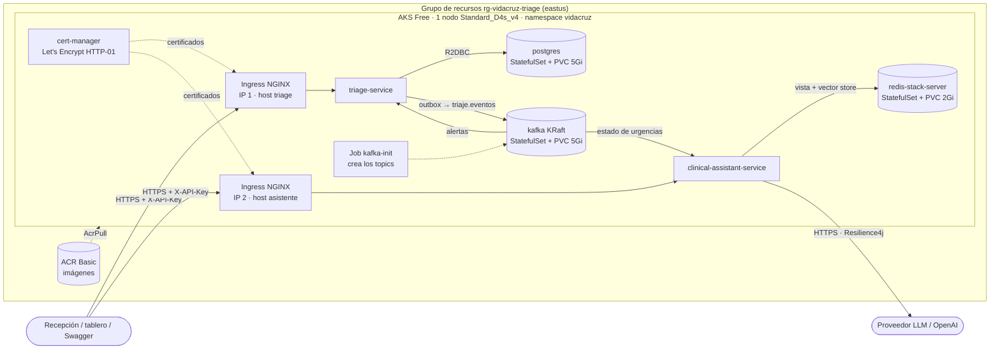

# Despliegue en Azure (AKS)

Guía operativa para desplegar, verificar y destruir VidaCruz Triage en Azure. Las decisiones y sus motivos están en el
[ADR 0008](adr/0008-despliegue-en-aks.md); la autenticación en el [ADR 0007](adr/0007-autenticacion-por-api-key.md); HTTPS en el
[ADR 0009](adr/0009-https-con-ingress-nginx-y-cert-manager.md).

## Arquitectura



* **Solo el controlador de ingreso es público**, con TLS (`https://<etiqueta>.eastus.cloudapp.azure.com`; HTTP redirige a HTTPS).
  Los `Service` de triage y del asistente, PostgreSQL, Kafka y Redis son `ClusterIP`. El triage **no** depende del asistente: si el
  LLM cae, el asistente responde 503 y el triage sigue.
* **Dos hosts, un controlador:** Azure da una etiqueta DNS por IP pública y ambos servicios sirven Swagger y *health* en la raíz, así
  que cada uno tiene su host. Un único `ingress-nginx` con dos `Service` `LoadBalancer` (dos IP, mismos pods) los atiende; elige el
  backend por el `Host`. Las rutas de la API no cambian. Detalle y alternativas: [ADR 0009](adr/0009-https-con-ingress-nginx-y-cert-manager.md).
* Kubernetes: `k8s/base` (namespace, ConfigMaps, StatefulSets, Job de topics, Deployments, Services), `k8s/overlays/azure` (imágenes
  del ACR y los `Ingress` con TLS) y `k8s/platform/` (ingress-nginx y los emisores de Let's Encrypt). Infraestructura: `infra/main.bicep`.

## Costo aproximado

Precios de la API de Azure (eastus, USD, sin impuestos), instalación con el disco del SO en el caso peor:

| Concepto | Cálculo | USD/día |
|---|---|---|
| Nodo `Standard_D4s_v4` | 0,192 USD/h × 24 | 4,61 |
| Balanceador Standard | 0,025 USD/h (incluye 5 reglas; datos procesados gratis) | 0,60 |
| 3 IP públicas Standard (2 servicios + 1 de salida) | 0,005 USD/h × 3 × 24 | 0,36 |
| Disco del SO 64 GiB (Premium P6, no efímero) | 10,21 USD/mes | 0,34 |
| ACR Basic | 0,1666 USD/día | 0,17 |
| Discos de datos (Standard SSD: 5 + 5 + 2 GiB) | 0,60 + 0,60 + 0,30 USD/mes | 0,05 |
| Plano de control AKS (plan Free) | | 0,00 |
| **Total** | | **≈ 6,1 (≈ 183 USD/mes)** |

HTTPS **no añade costo**: los dos `Service` del controlador usan las mismas dos IP públicas que antes tenían los `LoadBalancer` de los
servicios (se libera una pareja y se crea la otra), Let's Encrypt es gratuito y cert-manager/ingress-nginx suman unos 300 MiB de
memoria en el nodo. Los puertos 80 y 443 de los dos `Service` y la regla de salida suman 5 reglas, justo el límite incluido en el
balanceador Standard (cada regla extra costaría 0,01 USD/h).

El consumo del proveedor de IA (OpenAI) se factura aparte. Con 200 USD de crédito, el entorno encendido dura ~32 días.
**Para no gastar, destrúyelo cuando no lo uses** (sección final); volver a crearlo tarda ~10 minutos.

## Requisitos

* Azure CLI con sesión iniciada (`az login`), `kubectl` y **Docker en marcha** (las imágenes se construyen en local: ACR Tasks
  está bloqueado en suscripciones de prueba; ver ADR 0008).
* Una clave real de proveedor LLM en `LLM_API_KEY` (variable de entorno o `.env` de la raíz; nunca se versiona).
* Cuota de 4 vCPU libres en `eastus`. `Standard_B4ms` no está permitida por AKS en suscripciones de prueba; se usa
  `Standard_D4s_v4` (misma memoria). La talla se cambia con `-TamanoNodo` / `TALLA_NODO`.

## Desplegar desde cero

PowerShell (Windows) o Bash (`./infra/deploy.sh`, mismos pasos y nombres):

```powershell
./infra/deploy.ps1 -Paso cuota          # solo lectura: cuota de vCPU y proveedores registrados
./infra/deploy.ps1 -Paso plan           # solo lectura: qué recursos se crearán (what-if)
./infra/deploy.ps1 -Paso infra          # CREA grupo + ACR + AKS (empieza a generar costo)
./infra/deploy.ps1 -Paso imagenes       # docker build/push de los 2 servicios + az acr import de postgres/kafka/redis/busybox
./infra/deploy.ps1 -Paso credenciales   # kubeconfig de AKS
./infra/deploy.ps1 -Paso secretos       # Secret vidacruz-secrets (claves generadas en infra/.env.azure + LLM_API_KEY)
./infra/deploy.ps1 -Paso aplicar        # kubectl kustomize del overlay (apps + Ingress) + apply + espera a que todo esté Ready
./infra/deploy.ps1 -Paso plataforma     # cert-manager + ingress-nginx (2 IP públicas con etiqueta DNS) + emisores de Let's Encrypt
./infra/deploy.ps1 -Paso verificar      # pods, servicios, Ingress, certificados, URLs https y health
./infra/deploy.ps1                      # todo lo anterior (menos plan) de una vez
```

Todos los pasos son idempotentes (se pueden repetir): `cuota` se omite sola si el clúster ya existe (su nodo ocupa la
cuota), `aplicar` recrea el Job de topics, y los secretos generados se reutilizan. El tag de imagen es el hash corto de git
(`-wip<fecha>` si hay cambios sin commitear).

Parámetros: `-Region`, `-Prefijo`, `-GrupoRecursos`, `-TamanoNodo`, `-Namespace`, `-Emisor prod|staging` y `-VersionCertManager` (en
bash, variables `REGION`, `PREFIJO`, `GRUPO`, `TALLA_NODO`, `NAMESPACE`, `EMISOR`, `VERSION_CERT_MANAGER`).

### HTTPS: cómo funciona y cómo se prueba

1. `aplicar` deja los `Service` de los microservicios en `ClusterIP` (libera las IP y las etiquetas DNS de los antiguos
   `LoadBalancer`) y crea los `Ingress` con la anotación `cert-manager.io/cluster-issuer`.
2. `plataforma` instala cert-manager (versión fijada) e ingress-nginx; los dos `Service` del controlador reclaman las etiquetas DNS y
   cert-manager, al ver los `Ingress`, pide un certificado a Let's Encrypt por HTTP-01 (monta un `Ingress` temporal en el puerto 80
   del host). Al validarlo guarda el certificado en los `Secret` `triage-tls` y `asistente-tls` y lo renueva solo.
3. `verificar` espera a que los dos `Certificate` estén `Ready`, imprime las URLs `https://…`, comprueba el *health* y que HTTP
   redirige a HTTPS.

Si el certificado no sale (`kubectl -n vidacruz get certificate,order,challenge`): casi siempre es DNS aún sin propagar o el puerto 80
inalcanzable. Para probar el flujo sin gastar el cupo de Let's Encrypt (5 fallos de validación por hora y host): `-Emisor staging`
(sus certificados **no** son de confianza: `curl -k`, o `INSEGURO=1` / `-NoVerificarCertificado` en la demo) y luego `-Emisor prod`.
Migrar desde los `LoadBalancer` antiguos implica una interrupción de pocos minutos (la etiqueta DNS solo puede estar en una IP).

### Dónde quedan las claves

`infra/.env.azure` (ignorado por git) guarda `POSTGRES_PASSWORD`, `REDIS_PASSWORD`, `TRIAGE_API_KEY` y `ASSISTANT_API_KEY`
generadas al azar. **Nunca se imprimen.** Para usarlas en un `curl`, léelas de ese archivo:

```bash
set -a; . infra/.env.azure; set +a
curl -H "X-API-Key: $TRIAGE_API_KEY" https://<etiqueta-triage>.eastus.cloudapp.azure.com/triage/pacientes/<id>
```

## Verificar

`./infra/deploy.ps1 -Paso verificar` imprime pods, servicios, las URLs y el health. A mano:

```bash
kubectl get pods,svc,ingress,certificate -n vidacruz      # todo Running/Ready; kafka-init en Completed; certificados Ready
kubectl get svc -n ingress-nginx                           # las dos IP públicas del controlador
kubectl -n vidacruz logs deploy/triage-service --tail=50  # logs JSON con correlationId
URL_T=https://<etiqueta-triage>.eastus.cloudapp.azure.com
URL_A=https://<etiqueta-asistente>.eastus.cloudapp.azure.com
curl $URL_T/actuator/health/readiness                      # {"status":"UP"}  (público)
curl -o /dev/null -w '%{http_code}\n' $URL_T/swagger-ui.html   # 200
curl -i $URL_T/triage/pacientes/00000000-0000-0000-0000-000000000000   # 401 sin API key
curl -sI http://<etiqueta-triage>.eastus.cloudapp.azure.com/ | head -3  # 308 -> https://
```

### Demo de punta a punta

`scripts/demo.ps1` / `scripts/demo.sh` recorren todo el flujo (E1-E6, validación, transiciones, estado de urgencias, reporte y las
3 consultas al asistente) contra cualquier entorno, con OK/FALLO por paso:

```powershell
./scripts/demo.ps1 -ArchivoEnv infra/.env.azure -UrlTriage https://<etiqueta-triage>.eastus.cloudapp.azure.com -UrlAsistente https://<etiqueta-asistente>.eastus.cloudapp.azure.com
```

```bash
ARCHIVO_ENV=infra/.env.azure TRIAGE_URL=https://<etiqueta-triage>.eastus.cloudapp.azure.com ASISTENTE_URL=https://<etiqueta-asistente>.eastus.cloudapp.azure.com ./scripts/demo.sh
```

En Azure el paso del escalamiento se omite solo (el SLA real de CRITICO es 5 min, más que la espera máxima de la demo) y lo dice.

Prueba funcional (la que se ejecutó al desplegar, con resultado esperado):

| Prueba | Resultado |
|---|---|
| `POST /triage/pacientes` con el paciente E1 (130 lpm, 180/110, SpO2 97, 36,8 °C, dolor 8, GCS 15, «Dolor torácico») | `201`, `nivel: CRITICO`, `slaMinutos: 5` |
| `PATCH /triage/pacientes/{id}/estado` `{"estado":"EN_CONSULTA"}` | `200` |
| Volver a `REGISTRADO` | `409` (transición inválida) |
| `GET /triage/reportes/operacion?desde&hasta` (hoy, `-05:00`) | `200`, 24 horas; la del registro con 1 registrado y 1 atendido |
| `GET /asistente/estado-urgencias` (unos segundos después) | `totalActivos: 1`, `CRITICO: 1` (llegó por Kafka a Redis) |
| `POST /asistente/consulta` «¿Cuáles son las medidas iniciales ante una crisis hipertensiva?» | `200`, respuesta con fuente `PROTO-001 / Medidas iniciales` |
| `POST /asistente/consulta` sobre algo fuera del corpus | `200`, «No existe un protocolo disponible…», `fuentes: []` |

## Despliegue continuo con GitHub Actions (OIDC)

Dos workflows en [`.github/workflows/`](../.github/workflows):

| Workflow | Cuándo | Qué hace |
|---|---|---|
| [`ci.yml`](../.github/workflows/ci.yml) | push y PR a `main` | un job por servicio (matriz): Java 21 (Temurin), caché de Gradle, `./gradlew check` (tests + JaCoCo + umbral de cobertura) y los reportes como artefactos. `ProveedorRealTests` se omite sola (no hay secretos). |
| [`deploy.yml`](../.github/workflows/deploy.yml) | manual (`workflow_dispatch`) y, **si se activa**, tras un CI verde en `main` | construye las dos imágenes (`docker build --platform linux/amd64`), las sube al ACR con el hash corto de git como tag y actualiza los Deployments de AKS (`kubectl set image` + `rollout status`). |

`deploy.yml` **reemplaza al `az acr build`**, que ACR Tasks bloquea en la suscripción de prueba: las imágenes se construyen en
el runner de GitHub. Se autentica con **OIDC** (credenciales federadas): GitHub pide un token de corta vida a Entra ID para
este repositorio y rama, así que **no hay ningún secreto de larga duración** en GitHub. Los identificadores (client, tenant y
suscripción) y los nombres de recursos son *variables* del repositorio, no secretos.

### Crear la identidad y la federación (una sola vez)

> **No se han ejecutado.** Son los comandos propuestos; requieren permisos de propietario en la suscripción (para el rol) y
> poder registrar aplicaciones en Entra ID. Ejecútalos con `az login` ya hecho y `gh auth login` (GitHub CLI) si quieres
> fijar las variables desde la terminal (o créalas a mano en *Settings → Secrets and variables → Actions → Variables*).

```bash
# 0) Datos de partida (nada de esto se imprime ni se versiona)
SUB=$(az account show --query id -o tsv)
TENANT=$(az account show --query tenantId -o tsv)
RG=rg-vidacruz-triage
AKS=aks-vidacruz-triage
ACR=$(az acr list -g "$RG" --query "[0].name" -o tsv)
REPO=SantiagoGL2/vidacruz-triage-digital          # <propietario>/<repositorio> de GitHub

# 1) Identidad (registro de aplicación + service principal), sin ninguna contraseña
APP_ID=$(az ad app create --display-name gh-vidacruz-deploy --query appId -o tsv)
az ad sp create --id "$APP_ID"

# 2) Credencial federada: solo los workflows de ESTE repositorio y de la rama main pueden pedir token
az ad app federated-credential create --id "$APP_ID" --parameters "{
  \"name\": \"github-main\",
  \"issuer\": \"https://token.actions.githubusercontent.com\",
  \"subject\": \"repo:${REPO}:ref:refs/heads/main\",
  \"audiences\": [\"api://AzureADTokenExchange\"]
}"

# 3) Permisos mínimos: subir imágenes al ACR y bajar las credenciales del clúster
az role assignment create --assignee "$APP_ID" --role AcrPush \
  --scope "$(az acr show -n "$ACR" --query id -o tsv)"
az role assignment create --assignee "$APP_ID" --role "Azure Kubernetes Service Cluster User Role" \
  --scope "$(az aks show -g "$RG" -n "$AKS" --query id -o tsv)"

# 4) Variables del repositorio (no son secretos)
gh variable set AZURE_CLIENT_ID       --repo "$REPO" --body "$APP_ID"
gh variable set AZURE_TENANT_ID       --repo "$REPO" --body "$TENANT"
gh variable set AZURE_SUBSCRIPTION_ID --repo "$REPO" --body "$SUB"
gh variable set ACR_NAME              --repo "$REPO" --body "$ACR"
gh variable set AKS_NAME              --repo "$REPO" --body "$AKS"
gh variable set AKS_RESOURCE_GROUP    --repo "$REPO" --body "$RG"

# 5) (Opcional) desplegar automáticamente tras cada CI verde en main
gh variable set DEPLOY_AUTOMATICO     --repo "$REPO" --body true
```

Comprobar: *Actions → Deploy a AKS → Run workflow*; el resumen del job muestra el tag desplegado y los pods. Para retirar el
acceso: `az ad app delete --id "$APP_ID"` (borra también la federación y los roles quedan huérfanos: elimínalos con
`az role assignment delete --assignee "$APP_ID"`).

Notas:

* La credencial federada solo vale para `ref:refs/heads/main`: el despliegue manual debe lanzarse **desde `main`** (un PR o otra
  rama no obtiene token). Para otras ramas o un *environment* de GitHub se añade otra credencial con su propio `subject`.
* El workflow asume la infraestructura ya creada (`infra/deploy.*`: grupo, ACR, AKS, secretos e imágenes de terceros importadas).
  Solo actualiza las imágenes de los dos servicios; si cambian los manifests de `k8s/`, aplícalos con `infra/deploy.* -Paso aplicar`.
* Si `az ad app create` falla por permisos, la suscripción de prueba no deja registrar aplicaciones a ese usuario: pide el rol
  *Application Developer* en Entra ID o usa una identidad administrada asignada por el usuario con credencial federada
  (`az identity federated-credential create`).

## Problemas conocidos

* `TasksOperationsNotAllowed` en `az acr build`: ACR Tasks no está permitido en suscripciones de prueba. Por eso las imágenes
  se construyen con Docker local (`infra/deploy.*`) o en el runner de GitHub ([`deploy.yml`](../.github/workflows/deploy.yml)).
* `The VM size … is not allowed in your subscription`: AKS excluye ciertas series (la B) en suscripciones de prueba; usa otra
  talla de 4 vCPU con cuota (`-TamanoNodo`). Si cambias de talla, añade su familia de cuota a la tabla de `Paso-Cuota`.
* Pod en `Pending`: casi siempre recursos (revisa `kubectl describe pod` y `kubectl describe node`). El nodo no tiene margen
  para réplicas extra.
* El asistente no pasa la readiness: espera a la indexación de protocolos (`indiceProtocolos` en
  `/actuator/health`); si falla, mira el proveedor LLM (`LLM_API_KEY`, saldo/cuota).
* Swagger UI está encendido y la API key viaja por HTTPS pero identifica a la aplicación, no a la persona: es un entorno de prueba.
* `ingress-nginx` está retirado upstream (sin parches de seguridad): ver [ADR 0009](adr/0009-https-con-ingress-nginx-y-cert-manager.md).
* Los `Ingress` aparecían en el namespace `default` y no enrutaban: el overlay no declaraba `namespace: vidacruz` (kubeconform solo valida la forma). Corregido en el overlay y vigilado en el CI (paso «todo recurso del overlay de Azure va en el namespace vidacruz»). Si pasa en otro overlay: `kubectl get ingress -A`.
* Certificado `Pending`: `kubectl -n vidacruz describe challenge`; suele ser el DNS aún sin propagar o el puerto 80 bloqueado.

## Destruir

Borra el grupo de recursos completo (AKS, ACR, discos, IP públicas y balanceadores). **Es irreversible: se pierden los datos
de PostgreSQL, Kafka y Redis.**

```powershell
./infra/destroy.ps1                       # pide escribir el nombre del grupo para confirmar
./infra/destroy.ps1 -Forzar -SinEsperar   # sin confirmación y sin esperar
```

(`./infra/destroy.sh [--forzar] [--sin-esperar]` en bash.) También elimina el contexto de `kubectl` y `infra/.env.azure`
(`-ConservarSecretosLocales` / `--conservar-secretos` los mantiene). Para comprobar que no queda nada:
`az group exists -n rg-vidacruz-triage` debe devolver `false`.
