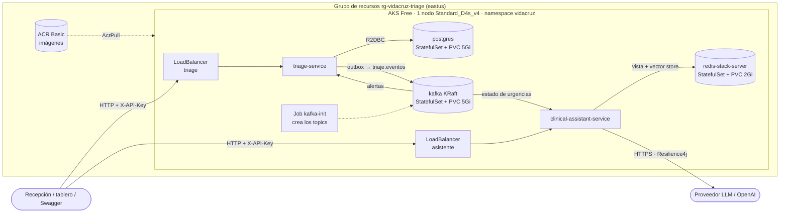

# Despliegue en Azure (AKS)

Guía operativa para desplegar, verificar y destruir VidaCruz Triage en Azure. Las decisiones y sus motivos están en el
[ADR 0008](adr/0008-despliegue-en-aks.md); la autenticación en el [ADR 0007](adr/0007-autenticacion-por-api-key.md).

## Arquitectura



* Solo los dos `LoadBalancer` son públicos (`<etiqueta>.eastus.cloudapp.azure.com`). PostgreSQL, Kafka y Redis son internos
  (`ClusterIP`). El triage **no** depende del asistente: si el LLM cae, el asistente responde 503 y el triage sigue.
* Parte de Kubernetes: `k8s/base` (namespace, ConfigMaps, StatefulSets, Job de topics, Deployments, Services) y
  `k8s/overlays/azure` (imágenes del ACR, `LoadBalancer`, etiquetas DNS). Infraestructura: `infra/main.bicep`.

## Costo aproximado

Precios de la API de Azure (eastus, USD, sin impuestos), instalación con el disco del SO en el caso peor:

| Concepto | Cálculo | USD/día |
|---|---|---|
| Nodo `Standard_D4s_v4` | 0,192 USD/h × 24 | 4,61 |
| Balanceador Standard | 0,025 USD/h (incluye 5 reglas; datos procesados gratis) | 0,60 |
| 3 IP públicas Standard (2 servicios + 1 de salida) | 0,005 USD/h × 3 × 24 | 0,36 |
| Disco del SO 64 GiB (Premium P6, no efímero) | 10,21 USD/mes | 0,34 |
| ACR Basic | 0,1666 USD/día | 0,17 |
| Discos de datos (Standard SSD: 5 + 5 + 2 GiB) | 0,60 + 0,60 + 0,30 USD/mes | 0,05 |
| Plano de control AKS (plan Free) | | 0,00 |
| **Total** | | **≈ 6,1 (≈ 183 USD/mes)** |

El consumo del proveedor de IA (OpenAI) se factura aparte. Con 200 USD de crédito, el entorno encendido dura ~32 días.
**Para no gastar, destrúyelo cuando no lo uses** (sección final); volver a crearlo tarda ~10 minutos.

## Requisitos

* Azure CLI con sesión iniciada (`az login`), `kubectl` y **Docker en marcha** (las imágenes se construyen en local: ACR Tasks
  está bloqueado en suscripciones de prueba; ver ADR 0008).
* Una clave real de proveedor LLM en `LLM_API_KEY` (variable de entorno o `.env` de la raíz; nunca se versiona).
* Cuota de 4 vCPU libres en `eastus`. `Standard_B4ms` no está permitida por AKS en suscripciones de prueba; se usa
  `Standard_D4s_v4` (misma memoria). La talla se cambia con `-TamanoNodo` / `TALLA_NODO`.

## Desplegar desde cero

PowerShell (Windows) o Bash (`./infra/deploy.sh`, mismos pasos y nombres):

```powershell
./infra/deploy.ps1 -Paso cuota          # solo lectura: cuota de vCPU y proveedores registrados
./infra/deploy.ps1 -Paso plan           # solo lectura: qué recursos se crearán (what-if)
./infra/deploy.ps1 -Paso infra          # CREA grupo + ACR + AKS (empieza a generar costo)
./infra/deploy.ps1 -Paso imagenes       # docker build/push de los 2 servicios + az acr import de postgres/kafka/redis/busybox
./infra/deploy.ps1 -Paso credenciales   # kubeconfig de AKS
./infra/deploy.ps1 -Paso secretos       # Secret vidacruz-secrets (claves generadas en infra/.env.azure + LLM_API_KEY)
./infra/deploy.ps1 -Paso aplicar        # kubectl kustomize del overlay + apply + espera a que todo esté Ready
./infra/deploy.ps1 -Paso verificar      # pods, servicios, URLs públicas y health
./infra/deploy.ps1                      # todo lo anterior (menos plan) de una vez
```

Todos los pasos son idempotentes (se pueden repetir): `cuota` se omite sola si el clúster ya existe (su nodo ocupa la
cuota), `aplicar` recrea el Job de topics, y los secretos generados se reutilizan. El tag de imagen es el hash corto de git
(`-wip<fecha>` si hay cambios sin commitear).

Parámetros: `-Region`, `-Prefijo`, `-GrupoRecursos`, `-TamanoNodo`, `-Namespace` (en bash, variables `REGION`, `PREFIJO`,
`GRUPO`, `TALLA_NODO`, `NAMESPACE`).

### Dónde quedan las claves

`infra/.env.azure` (ignorado por git) guarda `POSTGRES_PASSWORD`, `REDIS_PASSWORD`, `TRIAGE_API_KEY` y `ASSISTANT_API_KEY`
generadas al azar. **Nunca se imprimen.** Para usarlas en un `curl`, léelas de ese archivo:

```bash
set -a; . infra/.env.azure; set +a
curl -H "X-API-Key: $TRIAGE_API_KEY" http://<etiqueta-triage>.eastus.cloudapp.azure.com/triage/pacientes/<id>
```

## Verificar

`./infra/deploy.ps1 -Paso verificar` imprime pods, servicios, las URLs y el health. A mano:

```bash
kubectl get pods,svc -n vidacruz                          # todo Running/Ready; kafka-init en Completed
kubectl -n vidacruz logs deploy/triage-service --tail=50  # logs JSON con correlationId
URL_T=http://<etiqueta-triage>.eastus.cloudapp.azure.com
URL_A=http://<etiqueta-asistente>.eastus.cloudapp.azure.com
curl $URL_T/actuator/health/readiness                      # {"status":"UP"}  (público)
curl -o /dev/null -w '%{http_code}\n' $URL_T/swagger-ui.html   # 200
curl -i $URL_T/triage/pacientes/00000000-0000-0000-0000-000000000000   # 401 sin API key
```

Prueba funcional (la que se ejecutó al desplegar, con resultado esperado):

| Prueba | Resultado |
|---|---|
| `POST /triage/pacientes` con el paciente E1 (130 lpm, 180/110, SpO2 97, 36,8 °C, dolor 8, GCS 15, «Dolor torácico») | `201`, `nivel: CRITICO`, `slaMinutos: 5` |
| `PATCH /triage/pacientes/{id}/estado` `{"estado":"EN_CONSULTA"}` | `200` |
| Volver a `REGISTRADO` | `409` (transición inválida) |
| `GET /triage/reportes/operacion?desde&hasta` (hoy, `-05:00`) | `200`, 24 horas; la del registro con 1 registrado y 1 atendido |
| `GET /asistente/estado-urgencias` (unos segundos después) | `totalActivos: 1`, `CRITICO: 1` (llegó por Kafka a Redis) |
| `POST /asistente/consulta` «¿Cuáles son las medidas iniciales ante una crisis hipertensiva?» | `200`, respuesta con fuente `PROTO-001 / Medidas iniciales` |
| `POST /asistente/consulta` sobre algo fuera del corpus | `200`, «No existe un protocolo disponible…», `fuentes: []` |

## Problemas conocidos

* `TasksOperationsNotAllowed` en `az acr build`: ACR Tasks no está permitido en suscripciones de prueba. Por eso las imágenes
  se construyen con Docker local.
* `The VM size … is not allowed in your subscription`: AKS excluye ciertas series (la B) en suscripciones de prueba; usa otra
  talla de 4 vCPU con cuota (`-TamanoNodo`). Si cambias de talla, añade su familia de cuota a la tabla de `Paso-Cuota`.
* Pod en `Pending`: casi siempre recursos (revisa `kubectl describe pod` y `kubectl describe node`). El nodo no tiene margen
  para réplicas extra.
* El asistente no pasa la readiness: espera a la indexación de protocolos (`indiceProtocolos` en
  `/actuator/health`); si falla, mira el proveedor LLM (`LLM_API_KEY`, saldo/cuota).
* Las URLs son HTTP sin TLS y Swagger está encendido: es un entorno de prueba.

## Destruir

Borra el grupo de recursos completo (AKS, ACR, discos, IP públicas y balanceadores). **Es irreversible: se pierden los datos
de PostgreSQL, Kafka y Redis.**

```powershell
./infra/destroy.ps1                       # pide escribir el nombre del grupo para confirmar
./infra/destroy.ps1 -Forzar -SinEsperar   # sin confirmación y sin esperar
```

(`./infra/destroy.sh [--forzar] [--sin-esperar]` en bash.) También elimina el contexto de `kubectl` y `infra/.env.azure`
(`-ConservarSecretosLocales` / `--conservar-secretos` los mantiene). Para comprobar que no queda nada:
`az group exists -n rg-vidacruz-triage` debe devolver `false`.
